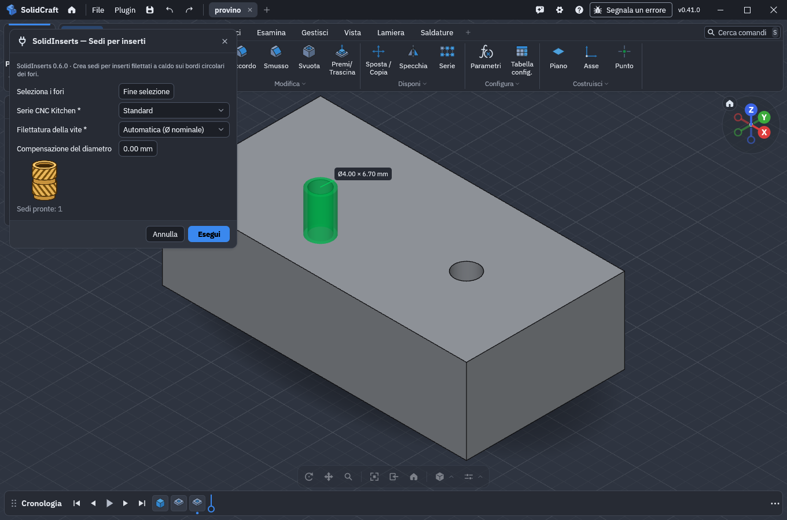

# SolidInserts

<picture>
  <source media="(prefers-color-scheme: dark)" srcset="../../assets/branding/solidinserts-logo-inverse.svg">
  
</picture>

[English](../../README.md) · [Italiano](../../README.it.md) · [Español](es.md) · [Français](fr.md) · [Deutsch](de.md) · [Português (Portugal)](pt.md) · [Русский](ru.md) · [简体中文](zh-CN.md) · **தமிழ்**

SolidCraft Desktop-இல் ஏற்கெனவே உள்ள துளைகளில் வெப்பத்தால் பொருத்தப்படும் திருகிழைச் செருகிகளுக்கான இருக்கைகளை உருவாக்குங்கள்.

ஒவ்வொரு இருக்கையையும் துளையின் வட்ட விளிம்பை அடிப்படையாகக் கொண்டு SolidInserts அமைக்கிறது. CNC Kitchen செருகி வரிசையையும் திருகு அளவையும் தேர்ந்தெடுத்து, ஒரே செயல்பாட்டில் பல இருக்கைகளை வெட்டலாம். வரைபடங்களையும் வெட்டுகளையும் SolidCraft மாதிரி வரலாற்றில் தொடர்ந்து திருத்தலாம். ஒருமுறை **Undo** செய்தால் அந்தச் செயல்பாட்டின் வெட்டுகள் அனைத்தும் நீங்கும்.

## SolidInserts-ஐ முயற்சி செய்யுங்கள்

1. [SolidCraft Desktop 0.42.0](https://github.com/tangency-labs/solidcraft/releases/tag/v0.42.0) பதிப்பைப் பயன்படுத்துங்கள். செருகுநிரலின் ZIP கிடைக்கும்போது [வெளியீடுகள் பக்கத்திலிருந்து](https://github.com/NoOneExceptEnderk/SolidInserts/releases) பதிவிறக்கலாம். அல்லது கீழுள்ள கட்டளைகளால் செருகுநிரலைத் தொகுத்து `dist/solidinserts-<version>.zip` கோப்பை உருவாக்குங்கள்.
2. உங்கள் கணினிக்கான செருகுநிரல் கோப்புறையில் ZIP கோப்பைப் பிரித்தெடுங்கள். `plugin.json`, `plugin.wasm` இரண்டும் `solidinserts` துணைக் கோப்புறையில் இருக்க வேண்டும்.

   | இயங்குதளம் | செருகுநிரல் கோப்புறை |
   | --- | --- |
   | Linux | `$XDG_DATA_HOME/solidcraft/plugins/` (பொதுவாக `~/.local/share/solidcraft/plugins/`) |
   | Windows | `%LOCALAPPDATA%\SolidCraft\plugins\` |
   | macOS | `~/Library/Application Support/SolidCraft/plugins/` |

3. [Ø3 மற்றும் Ø4 மிமீ துளைகள் உள்ள மாதிரியைத்](../../examples/pilot-holes.sc) திறக்கவும். செருகி நுழையும் பக்கத்தில் உள்ள வட்ட விளிம்புகளைத் தேர்ந்தெடுக்கவும். **Plugin → Insert Seats** என்பதைத் திறந்து, வரிசையையும் திருகிழை அளவையும் தேர்ந்தெடுத்து **Run** அழுத்தவும். SolidCraft கேட்கும்போது தொகுப்பை இயக்க ஒப்புதல் அளிக்கவும். வெட்டுகளின் முடிவை [முடிக்கப்பட்ட மாதிரியில்](../../examples/insert-seats.sc) பார்க்கலாம்.

## வெட்டுவதற்கு முன் முன்னோட்டம்

விருப்பமான டெஸ்க்டாப் திருத்தத்தின் மூலம் பலகையிலிருந்தே துளைகளைத் தேர்ந்தெடுக்கலாம். நீக்கப்படவுள்ள பொருள், இருக்கையின் விட்டம் மற்றும் ஆழம் ஆகியவற்றை வெட்டுவதற்கு முன் பார்க்கலாம். அந்தப் பலகை SolidCraft 0.42.0 வழங்கும் 36 மொழித் தேர்வுகளைப் பின்பற்றுகிறது. [திருத்தத்துடன் கூடிய டெஸ்க்டாப் பதிப்பைத் தொகுத்துப் பயன்படுத்தும் வழிகாட்டி](../../docs/desktop-preview.md).



*விருப்பத் திருத்தத்துடன் கூடிய டெஸ்க்டாப் முன்னோட்டம்.*

## ஆதரிக்கப்படும் செருகிகள்

SolidInserts ஒரு தனித்த செருகுநிரல். இதற்கு CNC Kitchen உடன் எந்த இணைப்பும் இல்லை. பட்டியலிடப்பட்ட செருகிகளுக்கான இருக்கை அளவுகள் CNC Kitchen வெளியிட்ட அளவுத் தாளை அடிப்படையாகக் கொண்டவை.

| CNC Kitchen வரிசை | திருகு அளவுகள் | M3 இருக்கை உதாரணம் (விட்டம் × ஆழம்) |
| --- | --- | --- |
| Standard | M2, M2.5, M3, M4, M5, M6, M8, M10 | Ø4 × 6.7 மிமீ |
| Short Version | M3, M4, M5 | Ø4 × 4 மிமீ |
| VORON M3 × 5 × 4 | M3 | Ø4.4 × 5 மிமீ |

தானியக்கத் தேர்வு, துளையின் விட்டத்திலிருந்து ±0.05 மிமீக்குள் இருக்கும் பெயரளவு திருகிழை விட்டத்தைப் பொருத்துகிறது. திருகு தளர்வாகச் செல்லும் துளை அல்லது திருகிழை வெட்டுவதற்கான தொடக்கத் துளைக்கு அளவைக் கைமுறையில் தேர்ந்தெடுக்கவும். எடுத்துக்காட்டாக, M3 திருகுக்கான Ø3.2 மிமீ துளையில் M3-ஐத் தேர்ந்தெடுக்கவும். தேர்ந்தெடுத்த வரிசை அனைத்துத் துளைகளுக்கும் பொருந்தும். தானியக்க முறையில் ஒவ்வொரு துளைக்கும் திருகிழை அளவு மாறலாம்.

தட்டையான முகப்பில் வட்ட வாயுள்ள உருளைத் துளைகளை SolidInserts ஏற்கிறது. சுற்றியுள்ள பொருளையும் கிடைக்கும் ஆழத்தையும் சரிபார்க்கிறது. ஊடுதுளைகளில் பழைய துளையின் ஒரு பகுதி தக்க வைக்கப்படுகிறது. இருக்கையின் ஆழம், செருகியின் நீளத்துடன் 1 மிமீ கூட்டிய அளவு. விட்டத் திருத்தத்தின் இயல்புநிலை பூஜ்ஜியம். இது விட்டத்தை மட்டும் மாற்றும். பொருத்தத்தைச் சரிசெய்ய ஒரு மாதிரியை அச்சிடுங்கள். [CNC Kitchen அளவுகளும் வடிவமைப்பு வழிகாட்டியும்](https://cnckitchen.com/s/CNCKitchen_Heat-Set-Insert-Dimensions-and-Design-Guidelines.pdf).

## தொகுத்துச் சோதனை செய்தல்

Cargo உடன் Rust, Bash, Python 3 மற்றும் [wasm-tools](https://github.com/bytecodealliance/wasm-tools) நிறுவவும். களஞ்சியத்தின் முதன்மைக் கோப்புறையிலிருந்து கீழுள்ள கட்டளைகளை இயக்கவும். தொகுப்பு செருகுநிரல் ZIP கோப்பையும் அதன் SHA-256 சரிபார்ப்பு மதிப்பையும் உருவாக்குகிறது. டெஸ்க்டாப் திருத்தம், விளக்கப்படங்கள், வழிகாட்டி ஆகியவற்றை ஒன்றாகத் தொகுக்கப் பிறகு `./package-preview-kit.sh` இயக்கவும்.

```sh
rustup target add wasm32-unknown-unknown
cargo test --locked
./build.sh
python3 tests/solidcraft.py --cli /path/to/solidcraft-cli
```

ஒருங்கிணைப்புச் சோதனை SolidCraft 0.42.0 CLI-ஐப் பயன்படுத்துகிறது. CLI அல்லது MCP நிரல்களில் மாதிரியைத் திருத்தாமல் அளவுகளைப் பெற, `plugin.run` வழியாக `applica`-ஐ `solo_quote: true` உடன் அழைக்கவும். SolidInserts, [SolidCraft செருகுநிரல் இயக்கச் சூழலைப்](https://github.com/tangency-labs/solidcraft/blob/v0.42.0/docs/plugin-runtime.md) பயன்படுத்துகிறது.

## உரிமமும் ஆதரவும்

SolidInserts ஒரு தனித்த செருகுநிரல். இது [MIT உரிமத்தின்](../../LICENSE) கீழ் வழங்கப்படுகிறது. [மூன்றாம் தரப்புப் பங்களிப்புகள்](../../NOTICE.md) · [Ko-fi வழியாக மேம்பாட்டை ஆதரிக்கவும்](https://ko-fi.com/enderk).
